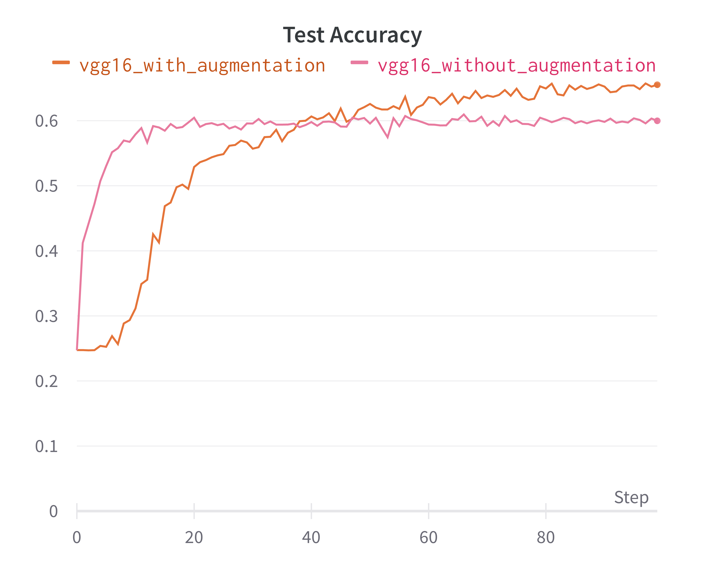
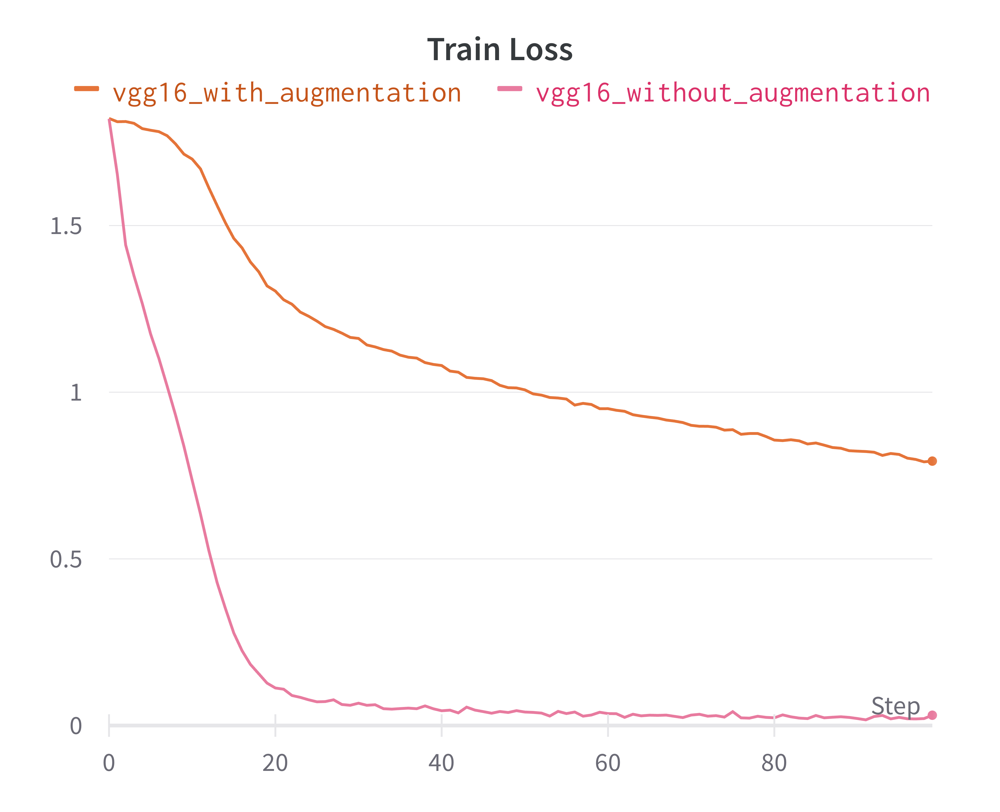
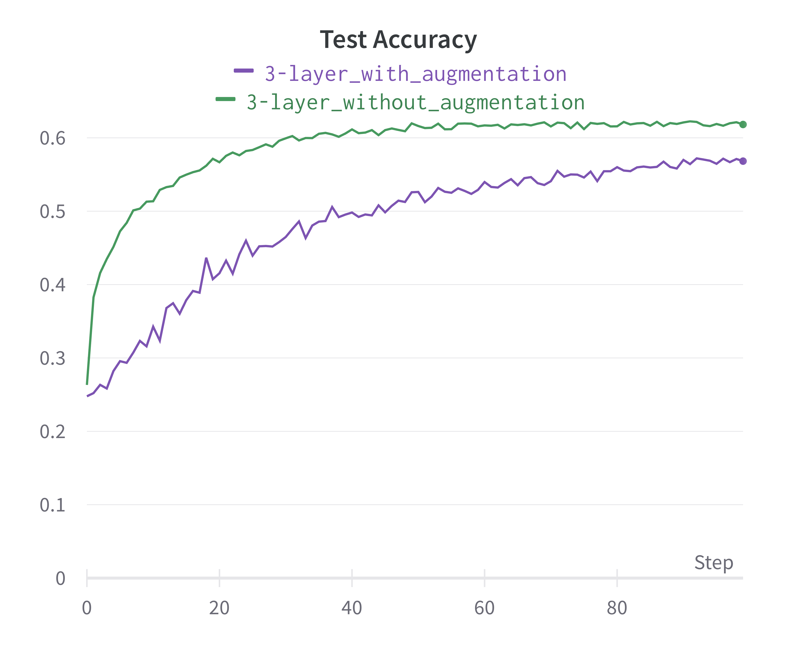
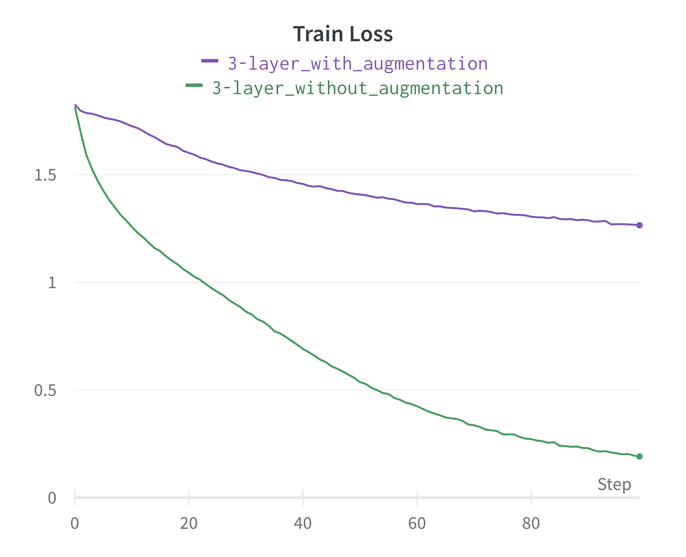

# Real-Time Facial Expression Recognition with CNNs


Seven-class facial expression recognition on FER2013, deployed as a real-time webcam demo. A compact custom CNN and VGG16 are compared, each trained with and without data augmentation, and the trained model runs on live video with OpenCV face detection.

*Graduate course project, UC Riverside (Apr–Jun 2023), team project. The full write-up is in [`Project_Report_group8.pdf`](Project_Report_group8.pdf).*


## Dataset

[FER2013](https://www.kaggle.com/datasets/msambare/fer2013) contains 48×48 grayscale face crops in seven classes: angry, disgust, fear, happy, sad, surprise and neutral. There are 28,709 training images and 3,589 public-test images.


## Method


- **Custom CNN** (`'3-layer'` in the code): a 4-conv network (32-64-128-128 filters) with max-pooling, dropout and a 1024-unit dense layer.
- **VGG16:** trained from scratch on 48×48×1 input.
- **Augmentation:** rotation, shifts, shear, zoom, and horizontal/vertical flips.
- **Real-time inference:** OpenCV Haar-cascade face detection; each face is cropped, resized to 48×48 and classified, and the predicted emotion is overlaid on the video.

## Results

VGG16 with augmentation gave the best test accuracy, about **65%** on the FER2013 public test set, against about 60% without augmentation, where test accuracy plateaus after roughly 20 epochs.

| VGG16: test accuracy | VGG16: training loss |
|:--:|:--:|
|  |  |
| **Custom CNN: test accuracy** | **Custom CNN: training loss** |
|  |  |

## Usage

```bash
pip install tensorflow opencv-python numpy wandb   # or: pip install -r code/requirements.txt (macOS / Apple-silicon pins)

# Train (expects FER2013 as image folders in data/train and data/test; logs to Weights & Biases)
python code/train_model.py

# Real-time demo (run from the repo root; uses weights/3-layer_with_augmentation.h5 by default)
python code/realtime_emotion_detection.py
```

Set `model_name` (`'3-layer'`, `'vgg16'` or `'vgg19'`) and `data_augmentation` at the bottom of each script.

## Repository structure

```
├── code/
│   ├── train_model.py                 # model definitions, data generators, training loop
│   ├── realtime_emotion_detection.py  # webcam demo
│   └── requirements.txt
├── weights/                           # trained custom-CNN weights + Haar cascade
├── Charts/                            # training / test curves
└── Project_Report_group8.pdf
```
